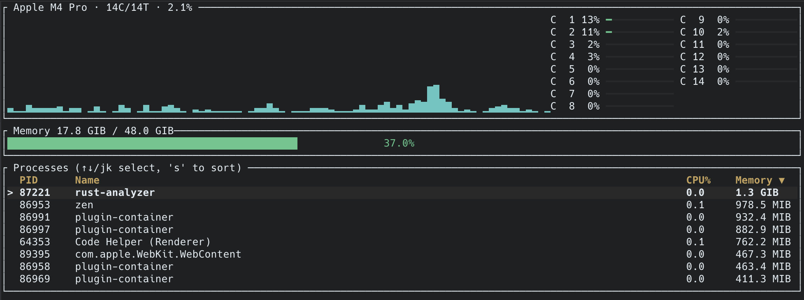

<div align="center">

# ferrostat

**A btop-style terminal system monitor, written in Rust.**

[](https://ratatui.rs/)





</div>


## Features

- **Live CPU and memory gauges**, updated every second
- **CPU history graph** that scrolls with the newest data on the right
- **Process table** showing PID, name, CPU usage and memory
- **Sortable** by CPU, memory, PID or name
- **Sticky selection**: the highlight follows a process as the list re-sorts
- **Cross-platform**: Linux, macOS and Windows, via [sysinfo](https://crates.io/crates/sysinfo)

## Installation

You'll need a recent [Rust toolchain](https://rustup.rs/).

Install straight from GitHub:

```sh
cargo install --git https://github.com/Matty-PW/ferrostat
```

Or clone and run it locally:

```sh
git clone https://github.com/Matty-PW/ferrostat
cd ferrostat
cargo run --release
```

## Controls

| Key             | Action                       |
| --------------- | ---------------------------- |
| `↑` / `k`       | Select previous process      |
| `↓` / `j`       | Select next process          |
| `s`             | Cycle sort column            |
| `q` / `Esc`     | Quit                         |

## Notes

- Process CPU usage is measured **per core**. A process fully using 4 cores shows 400%.
- CPU figures need two samples to calculate, so there's a short delay on startup before the first reading.

## Planned

- [x] CPU and memory gauges
- [x] CPU history graph
- [x] Process table with sorting and selection
- [ ] Per-core CPU view
- [ ] Disk and network panels
- [ ] Kill the selected process
- [ ] Filter processes by name
- [ ] Themes and a config file

## Built with

- [ratatui](https://ratatui.rs/): terminal UI framework
- [crossterm](https://github.com/crossterm-rs/crossterm): terminal backend and input
- [sysinfo](https://crates.io/crates/sysinfo): system and process information
